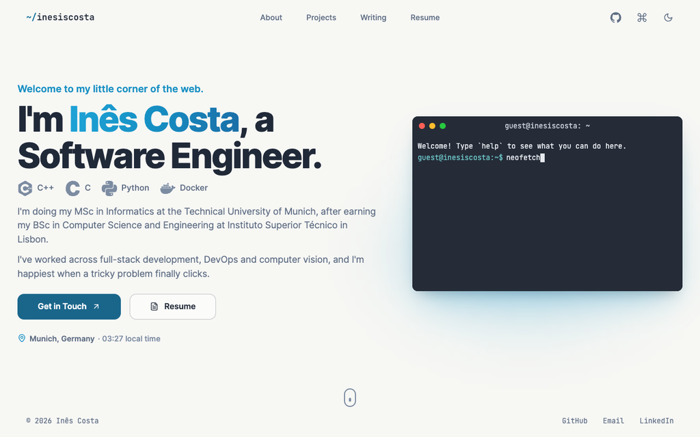

# Portfolio

<p align="center">
  
</p>

The code behind my personal site, [inesiscosta.com](https://inesiscosta.com), built as a template so anyone can
use it.

It's a SvelteKit site with a home page featuring an interactive terminal, an About page with a photo stack and a
timeline, a projects page, a resume visitors can tailor to what they're looking for, and a writing section built
for long technical posts. Every page is prerendered and served from a single Cloudflare Worker.

Out of the box it serves the placeholder content in `example-content/`, so it runs as soon as you clone it. Your own
content goes in `src/content/`: your profile, About text, resume, projects, posts, and your domain and Cloudflare
settings. That folder is ignored by git, so your content stays separate from the code. Photos and your CV go in an
R2 bucket rather than the repo.

## Try it

```bash
pnpm install
pnpm dev
```

Without a content repo, `example-content/` is copied in, so the site runs with placeholder content.
`example-content/writing/posts/writing-features.md` is a tour of everything a post can do: open `/writing` to read it.

## Make it yours

Create a private repo from `example-content/` and clone it into `src/content/`. Every file is checked against
`src/lib/content/schema.ts` (or, for posts, `src/lib/writing/posts.server.ts`) when the site loads it, so a mistake
fails `pnpm dev` and the build with the file and the field named, instead of reaching the site.

| Path | What it is |
|---|---|
| `site.yaml` | URL (and aliases like `www.`), Cloudflare account, Worker name, R2 bucket and its URL. `wrangler.jsonc` is generated from it. |
| `profile.yaml` | Name, GitHub handle, role, location, time zone, email, description, links. |
| `hero.yaml` | The home page's greeting, role, tech icons, text, and the terminal's files. |
| `about.yaml` | About text, stats and photos. |
| `timeline.yaml` | The About timeline. |
| `resume.yaml` | The resume, with the focus areas visitors can tailor it to. |
| `projects.yaml` | The project tiles, with their tags. |
| `pages.yaml` | The heading and intro of each page, and the contact section. |
| `writing/` | Posts, and what they need: see [Writing](#writing). |
| `static/` | Files served at the site root: project screenshots (`image: /images/projects/x.webp`) and whatever posts load. |

Add photos with `pnpm photo:add <file>`: it strips their metadata (including GPS location), uploads them, and prints
a key to paste into the YAML. `pnpm photo:rm <key>` deletes a photo once nothing uses it, and `pnpm cv:push <pdf>`
replaces your CV.

## Writing

A post is `writing/posts/<slug>.md`, published at `/writing/<slug>`: Markdown with Svelte inside. The engine does the
reading layout; a post only brings words and whatever makes it special. Start from the tour post,
`example-content/writing/posts/writing-features.md`, which uses every feature below.

```
writing/
  posts/<slug>.md         a post
  posts/<slug>/           components and files only that post uses
  components/             components several posts share
  pages/<path>.svelte     a standalone page at /<path>, for an app or demo a post needs a whole page for
static/                   files served at the site root: what posts load at runtime (a web worker, a data file,
                          a binary an emulator runs) and project screenshots
```

### Frontmatter

```yaml
title: "Required"
subtitle: "Optional, under the title"
date: 2026-11-25          # required
updated: 2026-12-01       # optional
kind: write-up            # write-up or note
tags: [Compilers, Systems]
summary: "Required: the card text, feed summary and search description."
tldr: "Optional box at the top."
featured: false           # true pins it first on /writing
draft: false              # true keeps it out of builds; it still shows in pnpm dev, marked as a draft
math: false               # KaTeX
justify: false            # justified text
```

### Features

- **Table of contents** on the left, built from the `##` and `###` headings (once there are two), with the current
  section highlighted as you read. It slides out of the way while a left-hand note passes it.
- **Sidenotes**: a numbered note right after the word it annotates, written on one line:
  `word<Sidenote>note</Sidenote>`. `side="left"` puts it in the left margin; `offset="1rem"` nudges it when two
  collide. On narrow screens it folds into the text.
- **Margin notes**: an unnumbered block (lists, code, images) beside a paragraph. Put `<MarginNote>` on its own, with
  blank lines around and inside it, just before the paragraph it belongs beside; it top-aligns with it.
- **Figures**: `<Figure caption="…">` around an image, an SVG or a component. They're numbered in order, so
  `[Figure 2](#figure-2)` always points at the right one.
- **Code**: highlighted for light and dark, with a language label and a copy button. A fence like
  ` ```python file=examples/fib.py def=fib ` is filled at build time with that function from `static/`, with
  line numbers continuing from where it starts in the file, so the post can't drift from the code it runs.
- **Maths** with `$inline$` and `$$display$$` KaTeX, when `math: true`.
- A **TL;DR** box, reading time, tags, a newer/older link, an RSS feed (`/feed.xml`) and search, all automatic.
- **Your own components**: anything Svelte can do. Import from the post's folder or `components/`, and from the
  engine (`#lib/components/writing/Sidenote.svelte`, `MarginNote.svelte`, `Figure.svelte`).

## Link previews

Every page gets a 1200×630 preview image for when its link is shared (WhatsApp, iMessage, Slack, LinkedIn, X): after
`pnpm build`, `scripts/og-screenshots.ts` opens each built page in headless Chrome and screenshots it, so the
preview is the page itself. Without Chrome (or with `CHROME_PATH` pointing nowhere) the build keeps a text card
instead, generated in `src/lib/og.server.ts`.

## Deploy

`.github/workflows/deploy.yml` builds this repo with your content repo and deploys it with Wrangler. It runs on
pushes here, weekly (so the age and commit-count stats stay current), and when your content repo calls it from a
`publish.yml` on every push, so publishing never needs a commit here:

```yaml
# .github/workflows/publish.yml in the content repo
on: { push: { branches: [main] }, workflow_dispatch: {} }
permissions: { contents: read }
jobs:
  deploy:
    uses: <you>/portfolio/.github/workflows/deploy.yml@main
    with: { site_repo: <you>/portfolio, content_repo: <you>/portfolio-content }
    secrets: inherit
```

It needs a repository variable `CONTENT_REPO` (`owner/name`) here; a secret `CLOUDFLARE_API_TOKEN` (Workers Scripts
and Routes: Edit) here and in the content repo; and here a secret `CONTENT_DEPLOY_KEY`, the private half of a
read-only deploy key on the content repo.

`pnpm run deploy` does the same from your machine.

## Commands

```bash
pnpm dev              # dev server, with drafts
pnpm tsc              # types and Svelte diagnostics
pnpm check            # lint and format (Biome)
pnpm build            # prerender into .svelte-kit/cloudflare, then index for search
pnpm preview          # build, then serve with the real Workers runtime
pnpm run deploy       # checks, build, deploy
pnpm photo:add <file> [name] | pnpm photo:rm <key> | pnpm cv:push <pdf>
```

## Licence

MIT © [Inês Costa](https://github.com/inesiscosta). See [LICENSE](LICENSE).
